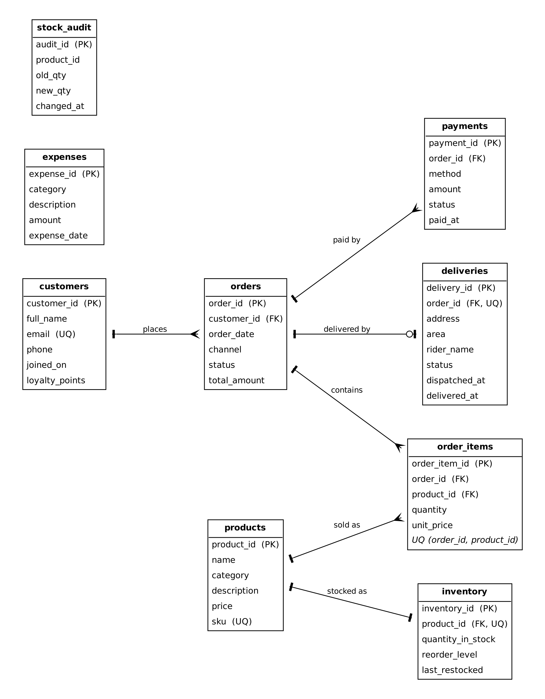
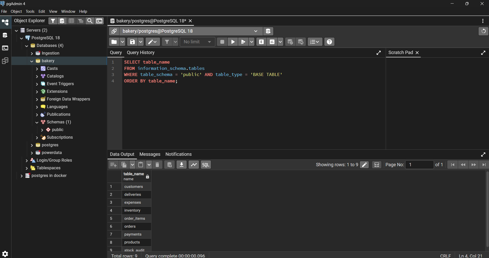
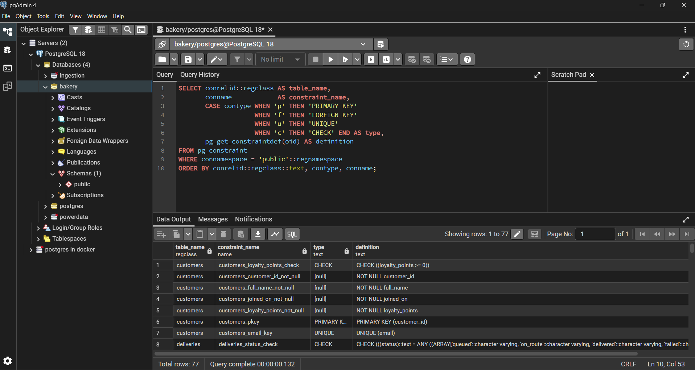
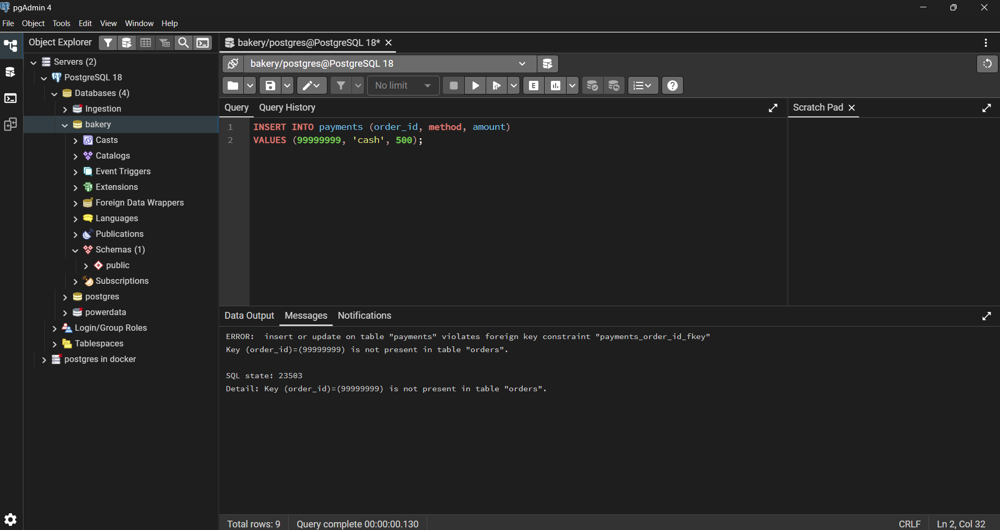
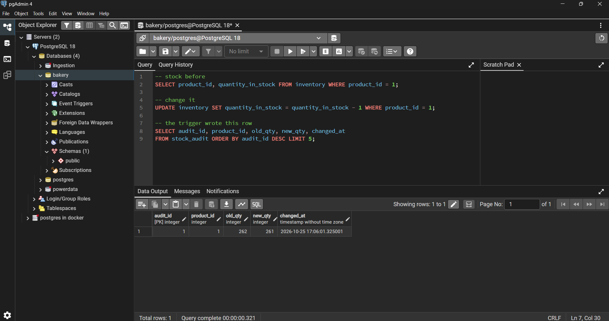
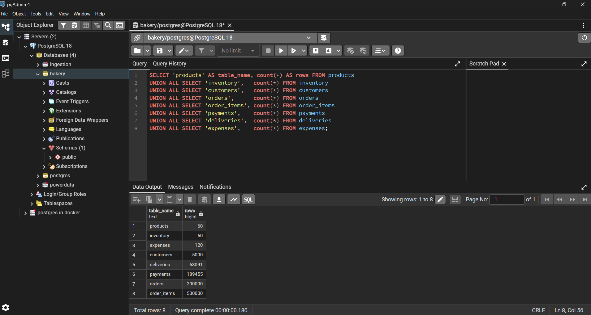

# Portfolio 1: Database Design and Modelling

## Goal

Design a relational database for Lilies Pastries, implement it in PostgreSQL with proper keys and constraints, load realistic test data, and justify the design through normalisation.

## Files

- `01_schema.sql`: creates all tables, constraints, the stock audit table and its trigger (rerunnable)
- `02_seed.sql`: generates the test data (rerunnable)
- `evidence/`: screenshots and the ER diagram

## How to run

1. Create an empty database and connect to it.
2. Run `01_schema.sql` (it drops and recreates the tables, so it deletes existing data).
3. Run `02_seed.sql`. It takes up to a minute or two.

## Design

The database has nine tables.

| Table | Purpose |
|---|---|
| `products` | the catalogue: name, category, price, SKU |
| `inventory` | stock level and reorder level, one row per product |
| `customers` | customer details and loyalty points |
| `orders` | one row per order: customer, date, channel, status, total |
| `order_items` | the lines of each order (junction between orders and products) |
| `payments` | payment attempts for an order |
| `deliveries` | delivery details for online orders |
| `expenses` | business costs, used for profit reporting |
| `stock_audit` | history of stock changes, written by a trigger |

**Relationships**

- One customer places many orders; each order belongs to one customer (1:N).
- An order contains many products and a product appears in many orders (M:N), resolved by `order_items`.
- An order can have several payments, because a failed attempt can be followed by a successful one (1:N).
- An order has zero or one delivery (1:0..1); `deliveries.order_id` is `UNIQUE`.
- Each product has one inventory record (1:1); `inventory.product_id` is `UNIQUE`.
- `expenses` and `stock_audit` stand alone: expenses are used for profit reporting and the audit table is filled by a trigger.

ER diagram :  

## Changes made to the original schema

I started from a five-table schema (`products`, `inventory`, `orders`, `order_items`, `expenses`) and improved it:

- Fixed a typo in a column name (`reoder_level` to `reorder_level`).
- Made foreign keys `NOT NULL` so no order line or stock record can be orphaned.
- Added `UNIQUE (order_id, product_id)` on `order_items` and `UNIQUE (product_id)` on `inventory` to stop duplicates.
- Added `CHECK` constraints: stock cannot go negative, prices and quantities must be positive, and statuses are limited to defined values.
- Added `customers`, `payments`, `deliveries` and `stock_audit`, so the schema supports the operations in the case study (customer history, taking payment, tracking delivery, stock audit).

## Constraints

| Constraint | What it prevents |
|---|---|
| primary keys on every table | duplicate or unidentifiable rows |
| foreign keys | an order for a customer who does not exist, a payment for a missing order |
| `CHECK (quantity_in_stock >= 0)` | overselling stock |
| `CHECK (price > 0)`, `CHECK (quantity > 0)` | nonsense prices and quantities |
| `CHECK (status IN (...))` | invalid statuses such as a typo |
| `UNIQUE (sku)`, `UNIQUE (email)` | duplicate products and customer accounts |

## Normalisation

I started from an imagined unnormalised order sheet: `order_no, order_date, customer_name, customer_phone, product1_name, product1_price, product1_qty, product2_name, ...`.

- **1NF:** the repeating product columns break the rule that each field holds one value. Each product line moves to `order_items`, one row per product per order.
- **2NF:** in `order_items` (key: order and product), the product name and price depend only on the product, which is part of the key. They move to `products`.
- **3NF:** customer name and phone depend on the customer, not on the order, so they live in `customers`. Every non-key column now depends on the key, the whole key, and nothing but the key.

`products.category` is a plain text column. This is not a strict 3NF violation, since the category has no attributes of its own, but a separate lookup table would prevent typos such as "Cake" and "Cakes". I kept it simple.

**Deliberate exceptions**

- `order_items.unit_price` copies the product's price at the time of sale, so changing a product's price later does not change old invoices.
- `orders.total_amount` is derived from the order lines. I keep it so order totals can be read quickly, and keep it correct inside the order-placing transaction (see Portfolio 3).

## Test data

The seed script generates [about] 60 products, 5,000 customers, 200,000 orders, [about] 500,000 order lines, payments for completed orders, deliveries for completed online orders, and 24 months of expenses. Volume matters because the execution plans in Portfolio 2 only show differences on large tables. Row counts from my database: [paste your own counts].

## Evidence

*Figure 1: The nine tables created in the Lilies Pastries database.*

*Figure 2: Constraints defined on the schema: primary keys, foreign keys, unique and check constraints.*

*Figure 3: An insert with an invalid order status is rejected by the status check constraint.*

*Figure 4: A product with a negative price is rejected by the price check constraint.*

*Figure 5: A payment for an order that does not exist is rejected by the foreign key.*

*Figure 6: Updating inventory fires the trigger, which records the old and new quantity in `stock_audit`.*

*Figure 7: Row counts after running the seed script.*

*Figure 8: Entity-relationship diagram of the Lilies Pastries database. A bar means one, a crow's foot means many, and a circle means optional.*