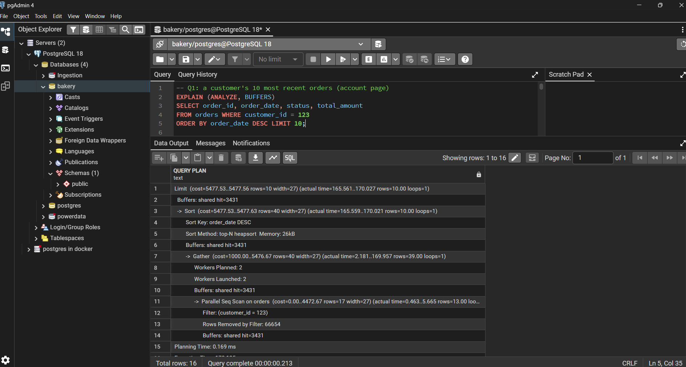
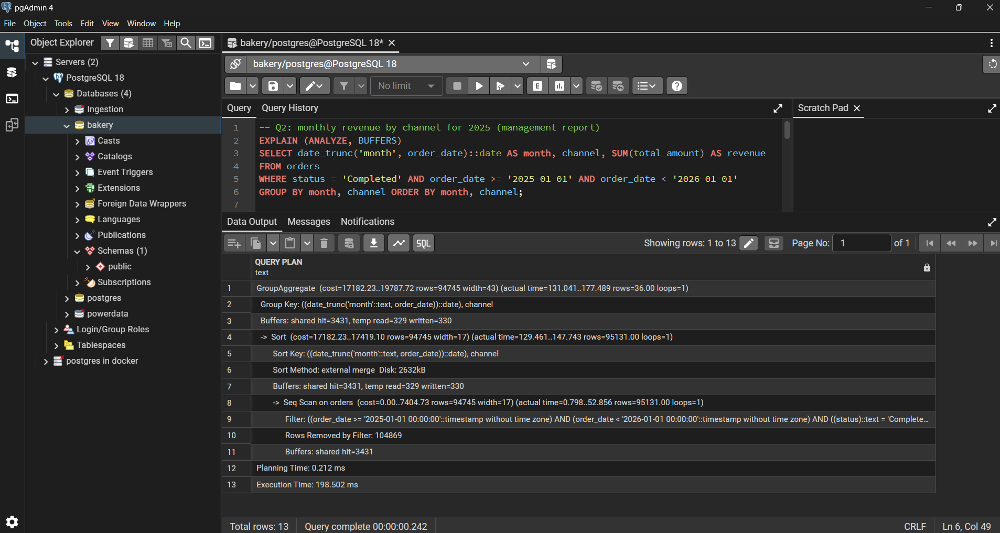
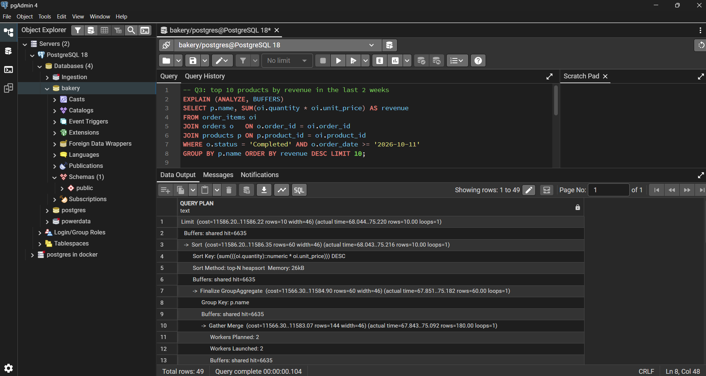
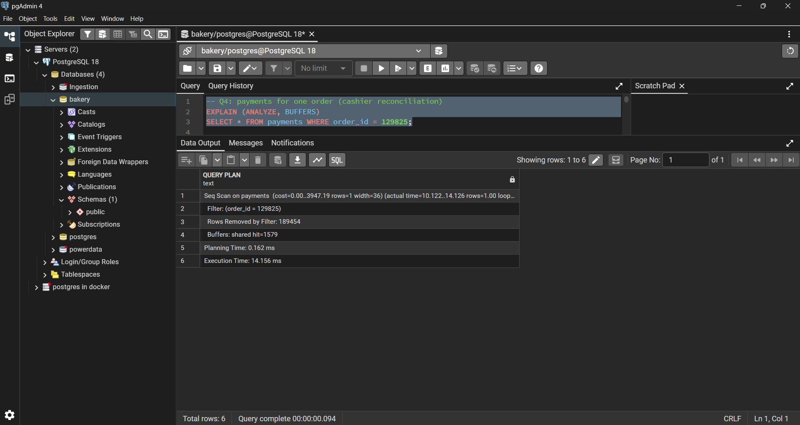
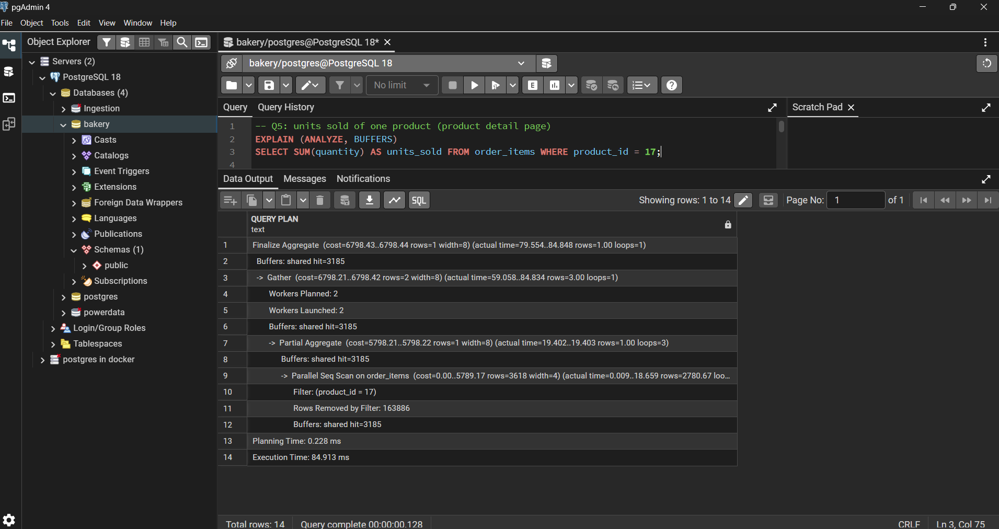
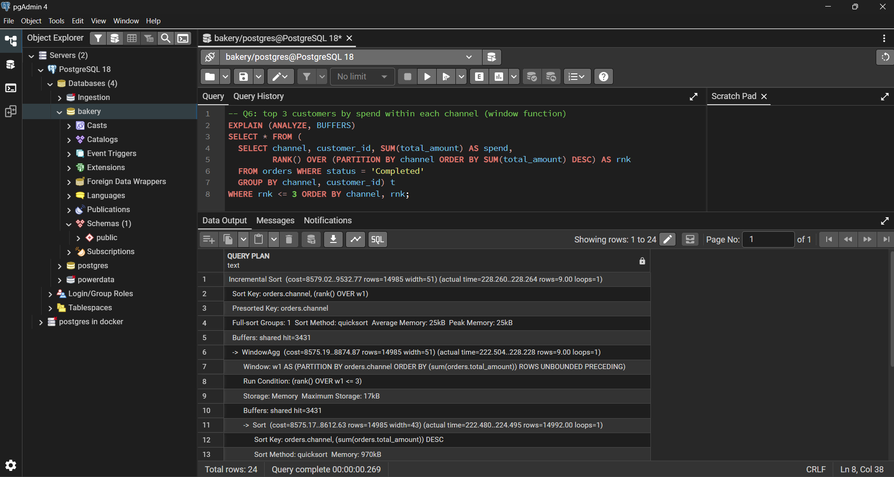
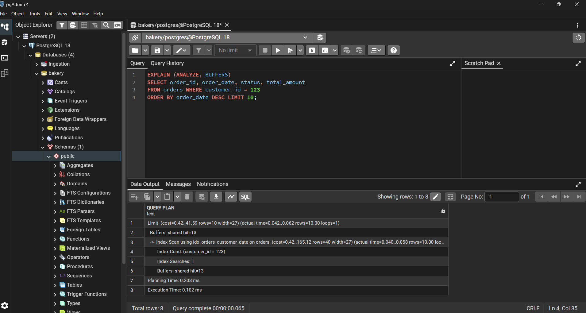

# Portfolio 2: Query Processing and Optimisation

## Goal

Analyse six realistic business queries on the Lilies Pastries database, record how PostgreSQL executes them, and improve the slow ones with indexes and a materialized view, measuring each change.

## Files

- `01_queries.sql`: the six queries
- `02_indexes.sql`: the indexes and the materialized view I created
- `evidence/`: execution-plan screenshots, before and after

## How to run

1. Load `01_schema.sql` and `02_seed.sql` from Portfolio 1 (about 200,000 orders and 500,000 order lines).
2. Run each query in `01_queries.sql` with `EXPLAIN (ANALYZE, BUFFERS)` in front of it. This is the baseline.
3. Apply the statements in `02_indexes.sql` one at a time. After each, run `VACUUM ANALYZE` on the table and repeat the query.

## Method

- **Baseline first.** I recorded each plan before creating any index, so only the primary-key and unique indexes existed.
- **Fair measurement.** I ran each query twice and kept the second run, so the first run's cache warm-up does not distort the comparison.
- **One change at a time**, so each improvement can be attributed to a single index.
- **Same query text and parameters** before and after (for example, always customer 123).

## The queries

| # | Business purpose | Features |
|---|---|---|
| Q1 | A customer's 10 most recent orders (account page) | filter, sort, `LIMIT` |
| Q2 | Monthly revenue by channel for 2025 (management report) | date range, `GROUP BY` |
| Q3 | Top 10 products by revenue in the last two weeks | three-table join, `GROUP BY` |
| Q4 | Payments for one order (reconciliation) | foreign-key lookup |
| Q5 | Units sold of one product (product page) | aggregate on a junction table |
| Q6 | Top 3 customers by spend in each channel | window function (`RANK() OVER`) |

## Results

| Query | Before (ms) | Change made | After (ms) | Plan change |
|---|---|---|---|---|
| Q1 | [ ] | composite index `(customer_id, order_date DESC)` | [ ] | Seq Scan to Index Scan |
| Q2 | [ ] | index on `order_date` with included columns, then a materialized view | [ ] | [describe] |
| Q3 | [ ] | none (not optimised) | unchanged | Seq Scans feeding hash joins |
| Q4 | [ ] | index on `payments(order_id)` | [ ] | Seq Scan to Index Scan |
| Q5 | [ ] | covering index `(product_id) INCLUDE (quantity)` | [ ] | Seq Scan to Index Only Scan |
| Q6 | [ ] | none | unchanged | Seq Scan, sort and window step |

Times are from my own machine, taken from the second run of each plan.

## What I observed

**Q1, Q4 and Q5 improved greatly.** Each needs a small slice of a large table, and the baseline plans read every row (for example, about [number] rows removed by the filter to return [number]). With a suitable index PostgreSQL jumps straight to the matching rows. For Q1 the composite index serves both the filter on `customer_id` and the sort on `order_date`, so no separate sort is needed. Q4 shows that PostgreSQL does not index foreign-key columns automatically. For Q5, including `quantity` in the index allowed an Index Only Scan, which reads no table pages at all, but only after `VACUUM`, because the visibility map must be up to date.

**Q2: an index helped little, a materialized view helped a lot.** The 2025 report reads a large share of all completed orders, so an index on `order_date` only changed the time from [ ] to [ ] ms. An index pays off when a query needs a small fraction of the table. Instead I pre-computed the monthly totals in a materialized view (`mv_monthly_revenue`), which brought the report to [ ] ms. I checked the view against the live data and the totals matched. The trade-off is freshness: the view is only as current as its last `REFRESH MATERIALIZED VIEW`, so it suits a nightly report and not a live dashboard.

**Q3: not optimised.** Q3 stayed at its baseline plan. The query touches only about 2% of orders, so a covering index on `order_items(order_id)` is the likely fix, but I did not implement or test it, so I make no claim about its effect.

**Q6: no index applies.** The query ranks every completed order, so it has to read most of the table whatever the indexes. I left it unchanged.

**Cost of indexes.** Indexes are not free. Each one takes storage [cite a size from your index-size query, if you ran it] and must be updated on every insert and update of the table, so I only kept indexes that serve a query I measured.

## Limitations

- Each time comes from one run on one machine, so absolute numbers will differ elsewhere. The plan changes are the reliable finding.
- The data is synthetic. Real data would have uneven distributions, which can change the planner's choices.
- Q3 is left unoptimised, and Q2's fix depends on refreshing the view.

## Evidence

Baseline plans (before any extra index):

*Q1 baseline: a parallel sequential scan of `orders` discards most rows to find one customer's orders.*

*Q2 baseline: a sequential scan and aggregation over a large share of `orders`.*

*Q3 baseline: sequential scans on `order_items` and `orders` feeding hash joins.*

*Q4 baseline: a sequential scan of `payments` to find one order's payment.*

*Q5 baseline: a parallel sequential scan of `order_items` to total one product's units.*

*Q6 baseline: a sequential scan, sort and window step over completed orders.*

After optimisation:

*Q1 after the composite index: an index scan returns the customer's latest orders already sorted.*
